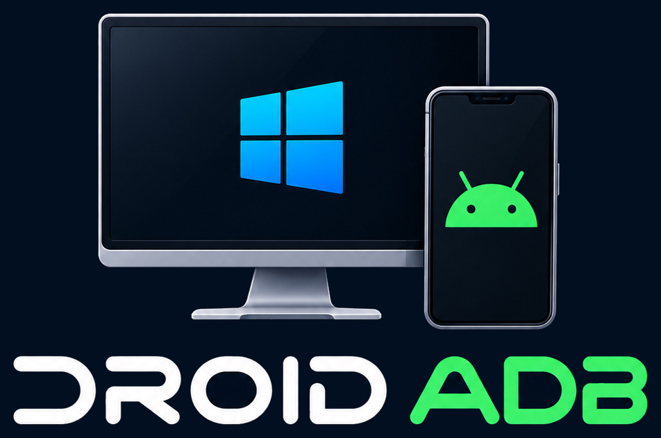

# DROID ADB 3.9

A portable Windows control center for your Android phone: mirror, record, screenshot, remote-control and manage it from a local dashboard.

DROID ADB is powered by [scrcpy](https://github.com/Genymobile/scrcpy) v5.0.1 (Genymobile, Apache 2.0). The scrcpy binaries in `core/scrcpy/` are unmodified. See `NOTICE.md` and `THIRD-PARTY-LICENSES.md`. DROID ADB is an independent project, not affiliated with or endorsed by Genymobile, Google or Microsoft.

## Start
1. Extract the whole ZIP to a writable folder.
2. Double-click `Launch.bat`. It starts the backend under a supervisor and opens http://127.0.0.1:47821/ (port is a setting).
3. `Stop.bat` shuts everything down. No Node.js, Python or internet needed; it uses Windows PowerShell 5.1 and .NET.

Open the dashboard through the address above. Opening `index.html` directly from disk is not supported.

## What changed in 3.9

3.9 adds four audio modes (Video only, Copy to recording, Copy and play on PC, Reroute audio to PC) with honest active status, a recording sound check and an OBS streaming guide, all in Studio, Capture. Default is Video only. Copy modes need Android 13 or newer. After updating, run Launch.bat once.

## What changed in 3.8

3.8 rebuilds Studio with seven live tabs, clickable cards that open interactive graphs (periods, zoom, CSV), profiles with animated progress and Undo, quick switches, sliders, per-core performance, a recorder, a battery tab and watchdog notices. The dashboard can now be installed as an app from Chrome (manifest and service worker added). After updating, run Launch.bat once.

## What changed in 3.7

3.7 turns Studio into a Performance Studio for gaming or any heavy app: a readiness score, live gauges (temperature, processor, memory, battery, frame rate, storage) with trends, smart suggestions with one-tap fixes, a Turbo profile with Undo, a cool-down assistant with cooling techniques, a network check, per-game profiles with Play and session history, and the old demo mode and capture presets under Capture. The Game Mode "not supported" error on Android 13 is fixed: the toolkit now tries the right commands and shows what the phone really answered. A package-name check that 3.6 accidentally weakened is restored. After updating, run Launch.bat once.

## What changed in 3.6

3.6 is a reliability and polish release. "Restart service" now restarts on the first click and waits until the new service is back (the old shutdown could hang). Errors are shown as plain sentences, and the original technical text is kept in Settings, Error log. The Remote controls Camera button now opens the phone camera. In Settings, Command preview sits above Backup and the About card is centered. Studio has a new Gaming kit: live battery and temperature, quick toggles, free memory, performance mode, Android Game Mode and frame stats. After updating, run Launch.bat once so the service loads the new version.

## What changed in 3.5

3.5 polishes the branding. New favicon and sidebar icon that stay clear at small sizes, the mirror window now really shows the DROID ADB icon (3.4 used a setting scrcpy 5 does not have), a DROID ADB "phone disconnected" screen, a one-click desktop shortcut with the DROID ADB icon, and the dashboard can be installed as an app from Chrome or Edge. See CHANGELOG.md.

To get the desktop shortcut, double-click `Create-Desktop-Shortcut.bat`. To install the dashboard as an app, open it in Chrome or Edge and use "Install DROID ADB" from the address bar or menu.

## What changed in 3.4

3.4 is the rebrand to DROID ADB: new name, logo, favicon, window titles and About panel, plus the licence notices. No features were removed. Old backups (`scrcpy-toolkit` files) still import. See CHANGELOG.md.

## What changed in 3.3

3.3 fixes the Usage errors for real, shows the individual messages inside a chat notification, and warns you (and restarts the service) when the background service is older than the page. IMPORTANT: after copying a new version over an old one, always run Launch.bat again; the page files update on refresh but the background service only changes when it restarts. See CHANGELOG.md.

## What changed in 3.2

3.2 fixes the Usage tab error (a temporary-file lock), adds enlargeable Monitor graphs with 24 hour history and a trading-style guide line, folds earlier notifications, moves the phone preview higher, shrinks the tap cursor and rebuilds the battery ring animation. See CHANGELOG.md.

## What changed in 3.1

3.1 is a safety and fixes release on top of 3.0 (saved data cannot be wiped, macros stop when asked, scheduled tasks no longer get lost, Enter works in dialogs). See CHANGELOG.md.

## What changed in 3.0
- Grouped navigation, new Studio, Automate, Monitor and Alerts pages, phone gallery and backups, macros and schedules, background jobs, inspector, insights, accent colours and more. See CHANGELOG.md.

## What changed in 2.5
- Bigger portrait phone, rebuilt charging animation, richer Media card (time, length, volume), balanced Console layout. See CHANGELOG.md.

## What changed in 2.4
- Real phone-body look, charging ring, animated rotate / pop-out transitions, coloured arrow cursor, Live indicator on the card. See CHANGELOG.md.

## What changed in 2.3
- **Phone card:** the preview is now a phone-shaped frame with battery, charging, temperature and connection details beside it. It follows the phone's real orientation and moves to the top when the phone is landscape.
- **Record while mirroring:** Mirror and Record are independent. A recording started during a mirror runs in the background (no second window).
- **Tap, swipe and drop on the picture;** battery trend, alerts, nicknames and shortcuts (U, L, C, ?). See CHANGELOG.md.

## What changed in 2.2
- **Running apps:** new Phone > Running tab lists apps with live processes, which one is in front, recent-apps order and memory use, with Open, Stop and Mirror app. Auto-refreshes.
- **Remote controls light up:** Shade, Quick, Screen and Mute are real toggles that show their state (Screen and Mute read the phone); every key gives press feedback.
- **App list rebuilt:** one phone call with a fallback, friendly names, and the phone's own error message if it refuses.

## What changed in 2.1
- **No more "offline" while recording.** The backend is now multi-threaded with a dedicated lane for status calls, so slow adb calls can no longer block the page. A supervisor restarts the backend if it ever dies. The page only reports a problem after three failed checks and never disables its buttons because of it.
- **Buttons show what happened.** Mirror and Record are real toggle buttons (pressed, busy spinner, live timer). Every action shows a busy state and a success or failure flash.
- **Nothing hardcoded.** About 68 settings in 8 groups: port, workers, folders, adb/scrcpy paths, timeouts, file name templates, refresh rates, stop grace time, extra scrcpy arguments and more. Settings, presets, named profiles, import/export and reset are all in the Settings page, which is built from the backend schema.
- **Much more to do.** Quick phone settings, app manager, phone file browser, phone log, adb shell, screen preview, wireless pairing and discovery, power actions, background recording, countdown, mirror a single app, library playback, rename and bulk delete, system check.

## Layout
- `index.html`, `assets/`: dashboard.
- `core/server/`: PowerShell backend (`server.ps1`, `supervisor.ps1`, `lib.ps1`, `handlers.ps1`, `routes-store.ps1`, `routes-phone.ps1`).
- `core/scripts/`: `start.ps1`, `launch.ps1` (used by `Mirror.bat` and `Record.bat`).
- `branding/`: the full DROID ADB logo set. `core/branding/`: icons used for the mirror window and the desktop shortcut (see the README.txt inside).
- `Create-Desktop-Shortcut.bat`: makes a DROID ADB shortcut with the logo on your Desktop.
- `NOTICE.md`, `THIRD-PARTY-LICENSES.md`, `LICENSE.txt`: attribution and licences (LICENSE.txt is the Apache 2.0 text that covers scrcpy).
- `Config/`: settings and profiles. `Recordings/`, `Screenshots/`, `Logs/`: data.

## Testing status
Developed and tested with PowerShell 7 on Linux using fake adb and scrcpy programs and a real browser (backend load tests, toggle flows, reconnect after backend loss, mobile layout). These Windows-only parts could not be run and need a quick check on a real PC: stopping a background (windowless) recording with Ctrl+C, finding the scrcpy child process, and the Open folder / Show in folder actions. The 3.0 features that read real phone output (notifications, usage stats, battery stats, uiautomator, demo mode) were tested only against fake adb output and need a check on a real phone. See `docs/REGRESSION-CHECKLIST.md`.

## Safety
The backend binds to 127.0.0.1 only, validates the Host and Origin headers and requires a custom header on every change request. Phone file changes are limited to /sdcard.
